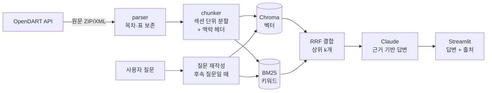

# 📑 DART 공시 분석 챗봇

> 상장사 사업보고서 원문을 검색해서 **출처와 함께** 답하는 RAG 챗봇입니다.
> "삼성전자 연구개발비는 매출 대비 몇 %야?" 같은 질문에 공시의 해당 페이지를 근거로 답합니다.

<!-- 배포 후 링크와 스크린샷/GIF 를 여기에 -->
**데모:** (배포 링크) · **스크린샷:** `docs/demo.gif`

## 왜 만들었나

사업보고서는 한 건에 수백 페이지이고, 필요한 숫자는 표 안에 흩어져 있습니다.
ChatGPT 같은 일반 챗봇에게 물으면 **그럴듯하지만 출처 없는 숫자**를 답하는 경우가 많습니다.
이 프로젝트는 금융감독원 전자공시 원문을 직접 수집·색인해서, 답변의 모든 문장이 **어느 보고서의 어느 목차**에서 나왔는지 확인할 수 있게 만드는 것이 목표입니다.

> 이전 프로젝트인 [주식 뉴스 메일 비서](링크)가 *매일 쏟아지는 뉴스*를 요약한다면, 이 프로젝트는 *회사가 직접 공시한 1차 자료*를 깊게 파고듭니다.

## 주요 기능

- **회사명만 입력하면 자동 수집**: OpenDART API로 최신 사업·반기·분기보고서 원문을 내려받아 색인
- **하이브리드 검색**: 의미 검색(임베딩 + Chroma)과 키워드 검색(BM25)을 RRF로 결합
- **출처 표시**: 답변 문장마다 `[1]`, `[2]` 표시, 클릭하면 DART 원문 페이지로 이동
- **후속 질문 이해**: "그럼 작년은?" 같은 질문을 이전 대화를 반영한 검색어로 자동 변환
- **보고서 범위 지정**: 특정 회사나 연도 보고서만 골라서 질문 (여러 회사 비교 가능)
- **정량 평가 스크립트**: 검색 방식별 Hit@k, MRR, 인용률 측정
- **📊 실적 그래프**: DART 재무제표 API의 공식 수치로 최근 6년 매출·영업이익·순이익과 이익률 추이 표시
- **⚖️ 회사 비교**: 2~3개 회사를 사업 구조, 연구개발, 인력, 주주, 배당, 리스크 항목별로 표 비교 (항목별 검색 후 Claude 1회 호출)
- **📄 기업 요약 리포트**: 버튼 하나로 출처가 달린 한 페이지 리포트 생성, HTML로 내려받아 PDF 저장 가능
- **💰 비용·속도 표시**: 답변마다 응답 시간, 토큰 수, 원화 비용 표시 (Sonnet 5.5 기준 질문 1건 약 10~30원)
- **👍👎 답변 평가**: 평가를 `data/feedback.jsonl`에 저장하고 만족도를 집계
- **회사 자동완성**: 전체 상장사 목록에서 이름 일부만 입력해도 검색

## 구조



```
dart-rag/
├── app.py              # Streamlit 화면
├── ingest.py           # 명령줄 수집 도구
├── src/
│   ├── dart_client.py  # OpenDART API (회사코드, 공시검색, 원문)
│   ├── parser.py       # DART XML → 목차별 텍스트 (표는 '셀 | 셀' 형태로 보존)
│   ├── chunker.py      # 섹션 경계를 지키는 청킹
│   ├── store.py        # Chroma + BM25 하이브리드 검색
│   ├── rag.py          # 프롬프트, Claude 호출, 인용 추출
│   └── ingest.py       # 수집 파이프라인
├── eval/               # 검색·답변 품질 평가
└── tests/              # API 키 없이 도는 테스트 17개
```

## 설계하면서 고민한 것

**1. 표를 어떻게 살릴까**
공시의 핵심 숫자는 대부분 표 안에 있습니다. HTML 태그를 그냥 지우면 `메모리8,520,00071.0` 처럼 숫자가 붙어버려 답변이 틀립니다.
표의 각 행을 `메모리 | DRAM, HBM | 8,520,000 | 71.0` 형태로 바꾸고, 표 위에 있는 `(단위 : 백만원)` 문구가 같은 청크에 남도록 했습니다.

**2. 청크를 어디서 자를까**
글자 수로만 자르면 '사업의 개요' 끝과 '주요 제품' 시작이 한 청크에 섞입니다. 그래서 **목차(섹션) 경계를 절대 넘지 않게** 자르고, 표는 행 단위로 자릅니다.
각 청크 앞에는 `[회사 | 보고서 | II. 사업의 내용 > 2. 주요 제품]` 헤더를 붙여서, 본문에 회사명이 없어도 검색되도록 했습니다.

**3. 왜 하이브리드 검색인가**
'HBM', '영업이익', '2025년' 같은 정확한 용어와 숫자는 키워드 검색이 강하고, "매출이 줄어든 이유" 같은 질문은 의미 검색이 강합니다.
형태소 분석기 없이도 한국어 조사 문제('영업이익**이**')를 피하려고 BM25 토큰에 **글자 2-gram**을 추가했습니다.

**4. 환각 줄이기**
시스템 프롬프트에서 발췌문 밖 내용은 "찾을 수 없다"고 답하게 하고, 숫자에는 단위와 기간을 반드시 붙이게 했습니다. 화면에서는 실제로 인용된 출처(✅)와 검색만 된 출처를 구분해서 보여줍니다.

## 성능 평가

`eval/questions.json` 의 질문 8개로, 정답 섹션이 상위 5개 안에 검색되는지 측정했습니다.

| 검색 방식 | Hit@5 | MRR |
|---|---|---|
| 벡터만 | (측정값) | |
| 키워드(BM25)만 | | |
| **하이브리드** | | |

| 답변 지표 | 값 |
|---|---|
| 출처 인용률 | |
| 평균 응답 시간 | |
| 질문 1건당 비용 | 약 ○○원 |

```bash
python eval/run_eval.py --rcept <접수번호>            # 검색 평가 (무료)
python eval/run_eval.py --rcept <접수번호> --answer   # 답변까지 (API 비용 발생)
```

## 실행 방법

```bash
# 1. 설치 (Python 3.10+)
python -m venv .venv && source .venv/bin/activate   # Windows: .venv\Scripts\activate
pip install -r requirements.txt

# 2. API 키 설정
cp .env.example .env     # DART_API_KEY, ANTHROPIC_API_KEY 입력

# 3. 공시 수집 (첫 실행 때 임베딩 모델 약 400MB 다운로드)
python ingest.py 삼성전자 SK하이닉스
python ingest.py --list

# 4. 챗봇 실행
streamlit run app.py
```

화면 왼쪽에서도 회사를 바로 수집할 수 있습니다.

```bash
python -m pytest -q   # 테스트 (API 키 불필요)
```

## 배포 (Streamlit Community Cloud, 무료)

- 시작 파일: `cloud/app.py` (같은 폴더의 가벼운 `cloud/requirements.txt`로 설치)
- 무료 서버 메모리 한도 때문에 배포본은 **키워드 검색 모드**로 동작합니다. 임베딩 모델 없이 BM25만 사용하고, 로컬에서는 하이브리드 검색을 씁니다.
- 서버 디스크는 재시작 때 지워지므로, 로컬에서 만든 검색 색인(`data/chroma`)을 저장소에 함께 올립니다.
- Secrets 설정 예시:

```toml
DART_API_KEY = "..."
ANTHROPIC_API_KEY = "..."
APP_PASSWORD = "데모 비밀번호"   # 비밀번호를 아는 사람만 사용
DAILY_LIMIT = "50"              # 하루 Claude 사용 횟수 한도 (질문·비교·리포트 각 1회)
```

## 기술 스택

Python · Claude API · ChromaDB · sentence-transformers (`jhgan/ko-sroberta-multitask`) · rank-bm25 · BeautifulSoup · Streamlit · OpenDART API

## 앞으로 해볼 것

- [ ] 재무제표 API(`fnlttSinglAcntAll`)를 붙여 숫자 질문은 정확한 수치 데이터로 답하기
- [ ] 두 회사 비교 질문 전용 모드 ("삼성전자 vs SK하이닉스 R&D 비중")
- [ ] 리랭커(cross-encoder) 추가 후 평가 지표 비교
- [ ] 주식 뉴스 메일 비서와 연동: 뉴스에 나온 회사의 최근 공시 요약을 메일에 함께 첨부

---
*공시 내용을 요약할 뿐 투자 권유가 아닙니다. 데이터 출처: 금융감독원 전자공시시스템(DART)*
